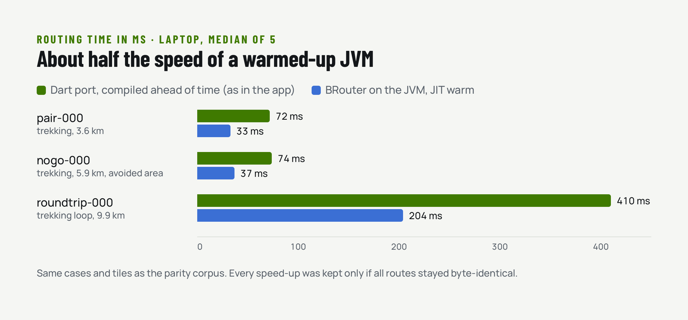

Velorki computes bike routes on the phone, with no server involved. The router is a port of [BRouter](https://github.com/abrensch/brouter), the open-source router behind many OpenStreetMap bike apps, from Java to Dart. This post is about how that port was done, and how we know it gives the same answer as the original.

## Why port it at all

A bike route that only works with a signal is not much use in the mountains or abroad without roaming. So the routing has to run on the device. BRouter was the obvious engine: its profiles for trekking, road, gravel and mountain bikes have years of tuning behind them, and its compact `.rd5` tiles carry everything the router needs for a 5 × 5 degree area in a few dozen megabytes.

BRouter is written in Java. On Android, Java runs. On iOS it does not, and Velorki is a Flutter app that has to run the same router on both, and later in the browser too. The options were:

- **Run BRouter on a server.** Needs a connection, costs money per request, and sends every route a rider plans to us. That was the thing to avoid.
- **Write our own router.** Years of work to reach what BRouter's profiles already do.
- **Port BRouter to Dart.** One code base for iOS, Android and the web, and the profiles keep working unchanged.

## A transliteration, on purpose

The port is deliberately mechanical: one Dart file per Java class, the same class names, the same methods in the same order, down to upstream's typos. No "improvements" inside ported files. Anything specific to Velorki lives in wrappers around them.

That sounds pedantic, but it is what makes the port maintainable. When BRouter releases a new version, its Java diff maps onto the Dart files one to one: find the changed class in the mapping table, make the same change in the same method. The moment a ported file starts to differ in spirit, that stops working.

The result is about 23,700 lines of Dart in 106 files, covering BRouter's `util`, `codec`, `mapaccess`, `expressions` and `core` modules.

## Making Dart behave like the JVM

The hard part was not the algorithms. It was the dozens of small ways Java and Dart disagree about numbers, which in a router decide which of two nearly equal paths wins.

- **32-bit integers.** Dart's `int` is 64 bits. Java's `int` overflows at 32 bits, and BRouter's hashing, CRCs and bit coders rely on that. The port wraps values explicitly wherever they can overflow or are shifted, with shift distances masked the way the JVM masks them.
- **`float`.** BRouter does its cost arithmetic in 32-bit floats. Dart has no `float` type, so every float operation rounds through a `Float32List`, 57 times per way section in the hottest function.
- **Remainders and casts.** Dart's `%` is never negative; Java's takes the sign of the dividend. Java's `(int)` cast of a double saturates and turns NaN into 0. `Math.round(0.49999999999999994)` is 0 in Java. Each has its own helper.
- **HashMap order.** One part of the search walks a `java.util.HashMap`, and the number of nodes it creates depends on the iteration order. The port has a small hash map with Java's bucket order and resize behaviour, so that walk happens in the same order.
- **Sine and cosine.** On HotSpot, `Math.sin` and `Math.cos` are compiled to Intel's math library, which agrees bit for bit neither with Java's own reference implementation nor with the C library the Dart VM calls. In BRouter's distance table of 1,800 precomputed scale factors, 60 entries came out different. The port transcribes the intrinsic's main path, checked bit-identical against 2,000,000 values sampled from the JVM. `Math.exp` got the same treatment.

## The oracle

Matching "most of the time" is not good enough for a router: a one-bit difference in a cost can flip a route. So the repository has an oracle: the real BRouter 1.7.10, run against two committed tiles (Madeira and the area around Reykjavík), with every result recorded.

The port is held to it at three levels:

| Level | What has to match |
|---|---|
| L1 | Byte-identical encoding and decoding of the tile format, including two real micro-caches from the tiles |
| L2 | Bit-identical evaluation of the routing profiles over a corpus of real way tags |
| L3 | 224 routing requests (point to point, via points, avoided areas, round trips, voice hints) across six profiles, with the produced GeoJSON compared byte for byte |

The first complete run of the routing core matched all of the 200 cases the corpus had then. Every coordinate, every message row, every travel time.

Recording the corpus turned up a few things in upstream itself, such as encoder calls that never terminate for `Integer.MAX_VALUE`. None of those values occur in real tile data, and the port reproduces them faithfully, because the rule is parity first.

## How fast is it

On a laptop, the port runs at about half the speed of a warmed-up JVM. A 67 km trekking route across Madeira takes 0.74 s compiled ahead of time, the way the release app runs. A performance pass afterwards made the long routes 10 to 20 % faster, and every step of it had to keep all corpus cases identical before it stayed. Memory peaks at about 76 MB for the whole run, including the worker isolate the app routes in.

## The same engine in the browser

The web planner at [app.velorki.com](https://app.velorki.com) runs this same router, compiled to WebAssembly. That works because Dart's `int` is 64 bits in WebAssembly, as on the phone. Compiled to plain JavaScript, where integers are doubles, the engine produced wrong routes, so the web build is WebAssembly only.

## Keeping up with upstream

A weekly job checks for a new BRouter release, replays the corpus against it and opens an issue with the differences. It never moves the pinned version by itself. Moving it means porting the release as a patch, re-recording the corpus and getting every case green again.

## Thanks

All of the routing knowledge in Velorki is BRouter's, by Arndt Brenschede and its contributors. The port lives in [`app/packages/brouter_dart`](https://github.com/orkitec/velorki/tree/main/app/packages/brouter_dart), with a README that maps every Java class to its Dart file, and the oracle in [`tools/brouter-oracle`](https://github.com/orkitec/velorki/tree/main/tools/brouter-oracle).
