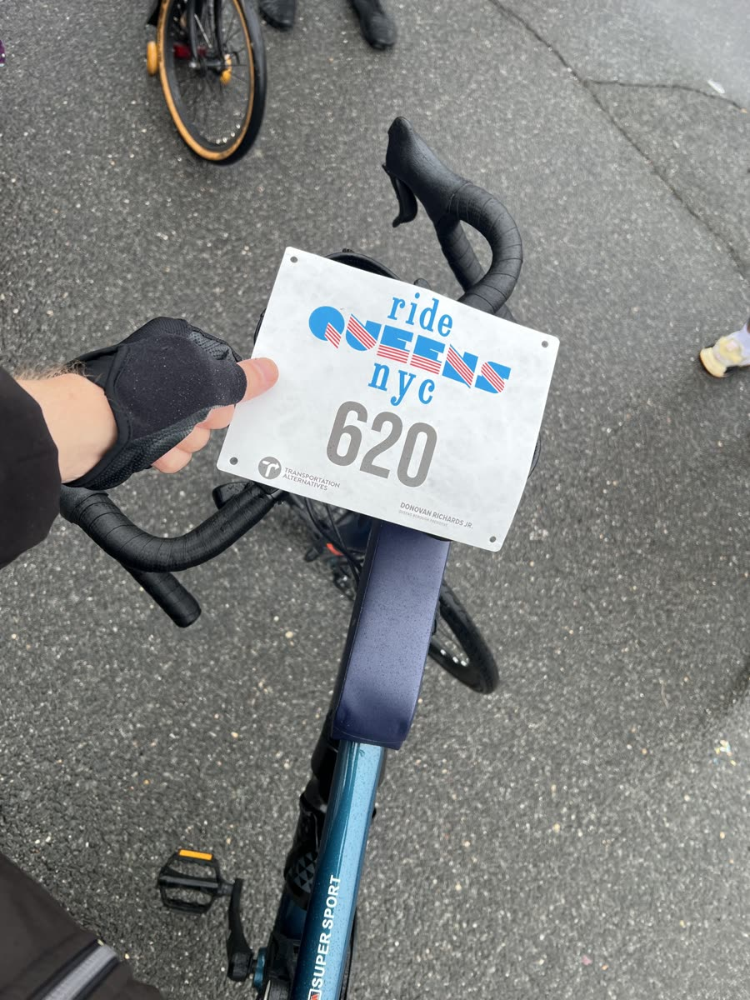
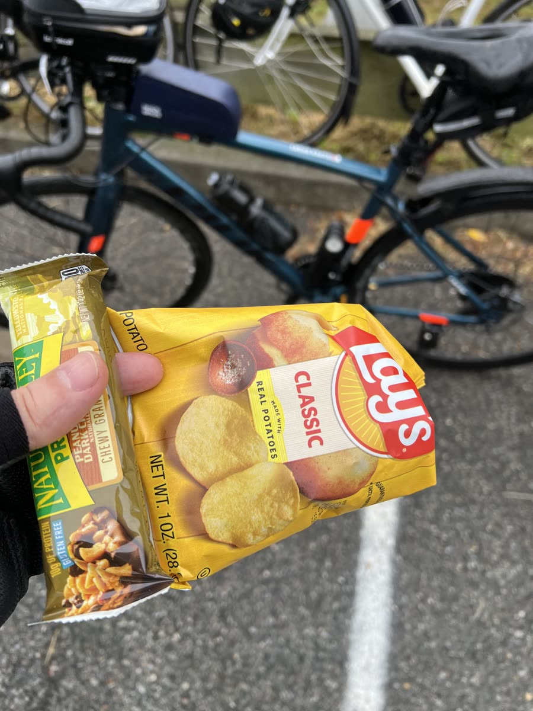
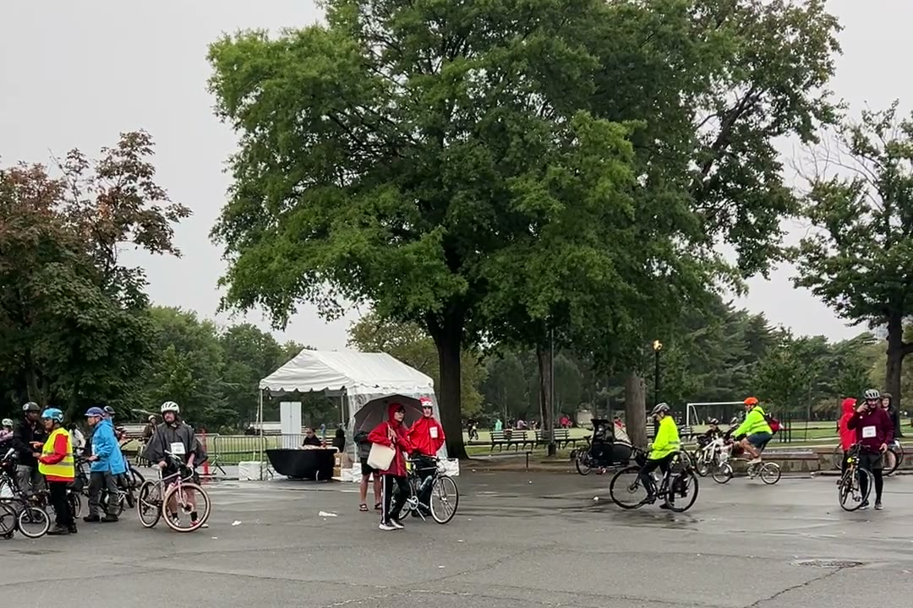

<!-- TODO(Steffen): everything marked TODO needs your own words before this goes live. Facts about the event are from the organisers' announcements. -->

On Sunday, 20 September 2026, I rode the first [Ride Queens](https://www.queensbp.nyc.gov/ridequeens/), a free community ride through the borough organised by the Queens Borough President's office together with NYC Parks and Transportation Alternatives. It was my first group ride in New York.

## The ride

Ride Queens started and finished at the Boathouse on Meadow Lake in Flushing Meadows Corona Park, at 10 a.m., rain or shine, as part of NYC Greenways Weekend. Riders picked one of two loops:

- **12 miles** through Central Queens
- **25 miles** out into Northern and Eastern Queens

Both followed the Eastern Queens Greenway and parts of the planned Queens Waterfront Greenway for most of their length. Registration was free and capped at 2,000 riders, and a festival in the park with food from all over the borough was planned for after the ride.

I rode the 25-mile loop, with number 620 on my back.

*My number before I put it on, and the snacks the volunteers handed out.*

## Riding with a crowd

The start went fine. It rained for the first hour and a half, but once I had got used to being wet, the rain turned out to be the least of my problems.

At roughly mile 13 my chain snapped. Then, less than a mile before the finish, I got a flat tyre. Both times the ride's volunteer marshals stopped and helped me get going again, and that was the best part of the day.

For the chain I was lucky. One of the marshals had a chain tool and a quick link with them, took out the broken link and joined the chain again. On my own that would have ended the ride.

The spare tube I carried myself, and I could have changed it alone. But after a long ride the help was very welcome, and their pump was a lot better than the mini pump in my bag. So I finished, quite late, but I finished.

## Velorki on the way

Velorki worked fine overall. The one thing that didn't was the heart rate from my Apple Watch, which was there for about the first 30 seconds and then gone. Of the 5,796 points the ride recorded, only 255 had a pulse. The ride's page still says so under its heart rate chart: "4 % of the ride".

The cause was the auto-pause. At the first stop, still at the start line, the app ended the watch's workout session. Once a watch app has no running session, watchOS suspends it within about a minute, so it never heard that the ride had started again. Every red light after that did the same.

I fixed it that same afternoon. The watch's session now pauses with the ride and resumes with it, which keeps the watch app awake. If the watch still goes quiet in the middle of a ride, the phone starts the watch app again. Since then the heart rate stays there on long rides too.

Keeping the session open costs the watch some battery while you stand still. So for rides with lots of stops there is a switch in the settings, under Apple Watch, that lets the sensor rest during a pause and wakes the watch again when the ride goes on. The heart rate should last the whole ride without draining the watch on the way.

## The figures

Velorki recorded the whole ride. This is the ride's page in the app, as is the map at the top of this post.

*Screenshot from Velorki.*

41.1 km is 25.5 miles. The gap between moving time and total time, almost an hour, is the chain and the flat tyre. The heart rate figures come from the few minutes the watch was connected.

## Next year

The Borough President's office wants Ride Queens to become an annual event, and I would ride it again next year. <!-- TODO(Steffen): a tip for someone riding it for the first time? Optional. -->
